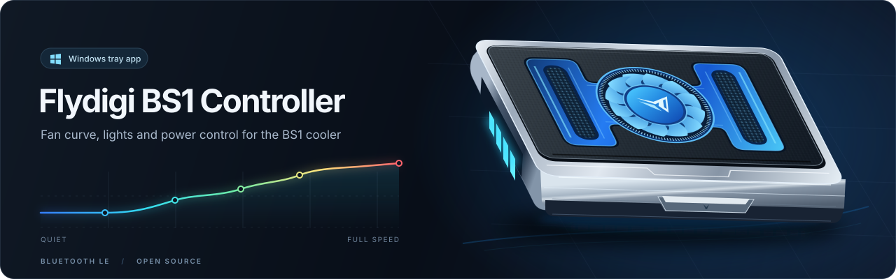

<p align="center">
  
</p>

<p align="center">
  <a href="../../actions/workflows/ci.yml"></a>
  <a href="../../releases/latest"></a>
  
  
  
  <a href="LICENSE"></a>
</p>

<p align="center">
  A small Windows tray app for controlling the <b>Flydigi BS1</b> laptop cooler over Bluetooth LE or USB.<br>
  A lighter replacement for Flydigi Space Station.
</p>

<p align="center">
  <a href="../../releases/latest"><b>⬇️ Download</b></a> ·
  <a href="#-features">Features</a> ·
  <a href="#-install">Install</a> ·
  <a href="#-troubleshooting">Troubleshooting</a> ·
  <a href="#️-build-from-source">Build</a>
</p>

## ✨ Features

- 🌀 **Smart fan:** follows CPU and GPU temperature, and speeds up early under heavy CPU/GPU load, before the heat shows. Stays at its quietest while the laptop is cool. Or set a fixed speed.
- 🍃 **Quiet mode:** a slower fan and dimmer lights while something plays (any app with sound), during calls, with Do Not Disturb or a presentation, on battery, or at night. Each one can be switched off. Never under heavy load: cooling comes first.
- 🌡️ **Temperatures:** CPU, every GPU, every disk and the motherboard, whatever the PC reports.
- 🌈 **Lights:** color by fan speed, steady color, breathe, wave, twinkle, fade; preset or custom colors; brightness. Lights off while the screen is locked.
- 🔄 **Firmware updates:** the app updates the cooler over USB, with a step-by-step guide. It can also put the official firmware back.
- 🔌 **Power:** off when Windows shuts down or sleeps; at logon turn on, stay off, or restore the last state.
- 🌍 **Languages:** English, Persian (right to left) and Chinese.
- 🪟 **Windows 11 look:** Mica, light and dark theme, your accent color.

## 📋 Requirements

- Windows 10 version 2004 or newer, x64.
- Bluetooth LE, or a USB-C cable that carries data.
- A Flydigi BS1 cooler.
- Administrator rights for CPU/GPU temperatures (set up by the installer).

The app has been tested on the BS1. The EVA edition advertises the same Bluetooth name and protocol but has **not been tested**.

## 📦 Install

1. Close Flydigi Space Station and disable it in Windows startup settings. Only one app can talk to the cooler at a time.
2. Download `BS1Cooler-Setup-x.y.z.exe` from the [latest release](../../releases/latest).
3. Run the installer.

The installer includes the .NET runtime. It creates a logon task that starts the app with administrator rights, without a UAC prompt at each logon. On first start, a short setup finds the cooler and offers a firmware update if it needs one.

## 🛠️ Usage

Click the tray icon to open the app; right-click it for on/off and exit. The icon shows a leaf while quiet mode is on.

Settings and logs are stored in `%APPDATA%\BS1Cooler`:

| File | Purpose |
| --- | --- |
| `settings.json` | Saved settings |
| `bs1cooler.log` | Application log |

**Settings → Report a problem** copies a report (version, firmware, temperatures, the end of the log) and opens this folder.

To uninstall, open Windows **Installed apps** and remove the app.

## 🩺 Troubleshooting

### The cooler does not connect

Check that Bluetooth is on and the cooler is in range, or plug it in with a data cable. Close Flydigi Space Station completely and disable its startup entry.

### Firmware update: the cooler isn't found

Use a cable that carries data (not charge-only) and plug it straight into the PC, not a hub. Hold the power button before the cable goes in. If Windows has no driver for the update mode, the app offers to install it.

### CPU/GPU temperatures are unavailable

Temperatures are read with [LibreHardwareMonitor](https://github.com/LibreHardwareMonitor/LibreHardwareMonitor) and need administrator rights. Windows Defender blocks its driver on some PCs; fan control still works then, but use a fixed speed.

## 🏗️ Build from source

Install the .NET 10 SDK and [Inno Setup 6](https://jrsoftware.org/isinfo.php), then from the repository root:

```powershell
dotnet build app -c Release   # the app
.\installer\build.ps1         # the self-contained installer, written to installer\out\
```

`core/` holds the cooler protocol and the fan and light logic; `app/` is the UI (Avalonia) and the Windows platform code. `Bs1Cooler --selftest` runs the built-in checks.

Every push to `main` is built and self-tested by [CI](.github/workflows/ci.yml). Pushing a tag like `v2.0.0` builds the installer and attaches it to that tag's release ([release workflow](.github/workflows/release.yml)).

## ⚠️ Disclaimer

This is an unofficial project and is not affiliated with Flydigi.

## 📄 License

[MIT](LICENSE)
