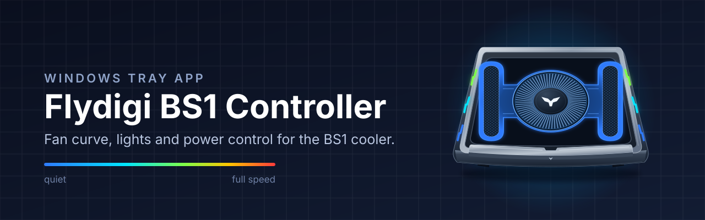

<p align="center">
  
</p>

<p align="center">
  <a href="../../releases/latest"></a>
  
  
  
  <a href="LICENSE"></a>
</p>

<p align="center">
  A small Windows tray app for controlling the <b>Flydigi BS1</b> laptop cooler over Bluetooth LE.<br>
  A lighter replacement for Flydigi Space Station.
</p>

<p align="center">
  <a href="../../releases/latest"><b>⬇️ Download</b></a> ·
  <a href="#-features">Features</a> ·
  <a href="#-install">Install</a> ·
  <a href="#-troubleshooting">Troubleshooting</a> ·
  <a href="#️-build-from-source">Build</a>
</p>

## ✨ Features

- 🌀 **Fan control:** follow CPU/GPU temperature using an editable fan curve, or run at a fixed speed.
- 🔇 **Quieter media playback:** optionally reduce fan noise during video or music.
- 🌈 **Lighting:** static, breathe, twinkle, fade, wave, or a steady color that follows fan speed, from blue when quiet to red at full speed. Adjust brightness and colors, with optional per-zone colors.
- 🔌 **Power management:** turn the cooler off when Windows shuts down or sleeps. At logon, turn it on, keep it off, or restore its last state.
- 📶 **Automatic connection:** connect when the cooler is in range.

## 📋 Requirements

- Windows 10 version 2004 or newer, x64.
- Bluetooth LE support.
- A Flydigi BS1 cooler.
- Administrator rights for CPU/GPU temperature monitoring.

The app has been tested on the BS1. The EVA edition advertises the same Bluetooth name and protocol but has **not been tested**.

## 📦 Install

1. Close Flydigi Space Station and disable it in Windows startup settings. Only one app can hold the cooler's Bluetooth connection at a time.
2. Download `BS1Cooler-Setup-x.y.z.exe` from the [latest release](../../releases/latest).
3. Run the installer and choose English or Persian for the installer interface.

The installer includes the .NET runtime, so nothing else needs to be installed.

Setup creates a logon task that starts the app with administrator rights, without a UAC prompt at each logon. These rights are needed to read CPU/GPU temperatures.

## 🛠️ Usage

Right-click the tray icon to open the settings window, turn the cooler on or off, or exit.

In settings, you can:

- Edit the temperature-based fan curve or choose a fixed fan speed.
- Enable quieter operation during video or music.
- Choose a light mode, brightness, and colors.
- Set the startup behavior: turn the cooler on, keep it off, or restore its last state.

At logon, the cooler plays a short yellow light animation, then switches to the selected light mode.

Settings and logs are stored in `%APPDATA%\BS1Cooler`:

| File | Purpose |
| --- | --- |
| `settings.json` | Saved settings |
| `bs1cooler.log` | Application log |

To uninstall, open Windows **Installed apps** and remove the app.

## 🩺 Troubleshooting

### The cooler does not connect

Check that Bluetooth is enabled and the cooler is in range. Close Flydigi Space Station completely. It cannot share the cooler's Bluetooth connection with this app. Disable its startup entry to prevent it from reconnecting at logon.

For connection problems, check `%APPDATA%\BS1Cooler\bs1cooler.log`.

### CPU/GPU temperatures are unavailable

Temperature monitoring requires administrator rights. Setup configures the app to start elevated at logon.

Temperatures are read using [LibreHardwareMonitor](https://github.com/LibreHardwareMonitor/LibreHardwareMonitor). Windows Defender flags its WinRing0 driver on some PCs. If the driver is blocked, fan control still works, but temperature readings may be unavailable. Use a fixed fan speed if temperature monitoring is unavailable.

## 🏗️ Build from source

Install the .NET 10 SDK and [Inno Setup 6](https://jrsoftware.org/isinfo.php), then run these commands from the repository root:

```powershell
# Build the app
dotnet build cooler -c Release

# Build the self-contained installer
.\installer\build.ps1
```

The installer is written to `installer\out\`.

## ⚠️ Disclaimer

This is an unofficial project and is not affiliated with Flydigi.

## 📄 License

[MIT](LICENSE)